# Talla

**AI-made UGC video adverts in Nigerian languages.**

Talla (Hausa for *"advertisement"*) turns a product into a researched, storyboarded, lip-synced, talking-head video advert in **Pidgin, Yoruba, Hausa, Igbo or Nigerian English**. An AI team researches the product and the audience, plans the shots, writes a native script, and films and edits the final vertical video. It also writes the caption you post it with.

| | |
|---|---|
| **Live Studio** | https://usetalla.pages.dev |
| **API** | https://talla-api.rcpt.workers.dev |
| **Built for** | Meta hackathon, November 2026 |

---

## Contents

1. [The problem](#the-problem)
2. [What Talla does](#what-talla-does)
3. [How it works](#how-it-works)
4. [Models used](#models-used)
5. [Languages and creators](#languages-and-creators)
6. [Architecture](#architecture)
7. [Repository layout](#repository-layout)
8. [Getting started](#getting-started)
9. [Demo mode and live mode](#demo-mode-and-live-mode)
10. [Deployment](#deployment)
11. [API reference](#api-reference)
12. [Budget guard](#budget-guard)
13. [Measured performance and cost](#measured-performance-and-cost)
14. [Responsible AI](#responsible-ai)
15. [Known limitations](#known-limitations)
16. [Roadmap](#roadmap)

---

## The problem

Small businesses in Nigeria sell through WhatsApp, Instagram and TikTok. What converts there is **UGC (user-generated content)**: a real-looking person talking to camera in the language the customer actually speaks.

- Hiring creators is slow and expensive for a small seller.
- Most AI video tools only speak English, and they sound foreign when they try anything else.
- Translated scripts lose the hooks, slang and rhythm that make an advert land locally.

## What Talla does

- **Researches** the product and the audience: pain points, objections and scroll-stopping hooks.
- **Storyboards** the advert scene by scene. Every scene can be edited before anything is filmed.
- **Writes the script natively** in the chosen language, with an English line under each one so the owner knows exactly what is said.
- **Casts a creator.** Four named on-screen creators each have a matching voice in every supported language.
- **Films it.** It generates the voice, lip-syncs the creator to it, and cuts the scenes together with burned-in captions.
- **Delivers a 1080×1920 vertical film** that is ready to post and downloadable from the Studio.
- **Writes the post**: the caption and hashtags.
- **Keeps every project.** Finished films reload from History at no cost, and you have to confirm before a re-render spends credits.

## How it works

```mermaid
flowchart LR
    A[Product + audience + language] --> B[Research agent]
    B --> C[Storyboard agent]
    C --> D[Script agent]
    D --> E[Keyframes + QC]
    E --> F[Voice per scene]
    F --> G[Lip-synced clip per scene]
    G --> H[Critic]
    H --> I[Stitch: captions + audio]
    I --> J[Verify spoken lines]
    J --> K[Finished film + caption]
```



| Stage | What happens | Runs on |
|---|---|---|
| **Research** | Audience pain points, hooks and angles, optionally enriched by scraping the product URL | Meta Muse Spark Open (Baseten), Firecrawl |
| **Storyboard** | Scene plan: speaker, shot, camera and the job of each line | Meta Muse Spark Open |
| **Script** | Native-language lines with English glosses | Meta Muse Spark Open |
| **Keyframes** | A first frame for each scene, using the chosen creator's face | Z-Image-Turbo (Modal) |
| **Keyframe QC** | Checks each frame has a person in it before any video is spent | OWLv2 (Modal) |
| **Voice** | One spoken track per scene, in the creator's voice | YarnGPT2 (Modal) |
| **Video** | Lip-syncs the creator to the voice | InfiniteTalk (Modal, H100) |
| **Critic** | Reviews each scene against the storyboard | Meta Muse Spark Open |
| **Stitch** | Normalises every clip to 1080×1920 / 24 fps and burns in two-line captions (spoken language + English) | FFmpeg (Modal) |
| **Verify** | Transcribes the finished audio and checks it matches the script | Meta MMS / Whisper (Modal) |
| **Post** | Caption and hashtags | Meta Muse Spark Open |

A film job is a **state machine**. `POST /generate` returns a job immediately, and each `GET /api/jobs/:id` poll advances it one step. That keeps every Worker request short and lets the Studio resume a job after a reload.

## Models used

| Model | Role | Licence / host |
|---|---|---|
| **Meta Muse Spark Open** (`muse-spark-open-1026`) | Research, storyboard, script, critic, caption | Baseten |
| **Meta MMS** (`mms-1b-all`, Yoruba/Hausa/Igbo adapters) | Verifying spoken Yoruba, Hausa and Igbo | CC-BY-NC-4.0, Modal |
| **InfiniteTalk** | Audio-driven lip-synced talking-head video | Modal H100 |
| **YarnGPT2** | Nigerian voices: Yoruba, Hausa, Igbo, Nigerian English (and Pidgin) | Modal |
| **Z-Image-Turbo** | Creator portraits and scene keyframes | Apache-2.0, Modal L40S |
| **OWLv2** | Keyframe quality check | Modal |
| **Whisper large-v3-turbo** | Verifying English and Pidgin lines | MIT, Modal |

> **Note on Meta's image, SAM and transcription APIs.** Talla was built to use Meta Muse Image (keyframes), SAM 3.1 (keyframe QC) and Muse Voice Transcribe (verify). On 2026-11-01 those endpoints returned `402 billing_not_configured`, so Talla swapped in the open models above. The Meta routes are still in the code and take over again as soon as they are reachable.

## Languages and creators

| Language | Voice source |
|---|---|
| Yoruba | YarnGPT2 Yoruba voice |
| Hausa | YarnGPT2 Hausa voice |
| Igbo | YarnGPT2 Igbo voice |
| Nigerian English | YarnGPT2 English voice |
| Pidgin | The creator's YarnGPT2 English voice, reading a Pidgin script |

Four on-screen creators (two women and two men) keep the same face across every scene: **Aisha, Funmi, Ebuka and Tunde**. Each one has a voice mapped per language. If a creator has no voice for the chosen language, Talla falls back to that creator's English voice **and shows a warning** rather than failing silently.

## Architecture

```
 Browser (Studio)                 Cloudflare                          Modal (GPU / CPU)
┌──────────────────┐   HTTPS   ┌────────────────────────┐  token  ┌────────────────────────┐
│ React + Vite     │ ────────► │ Worker (Hono API)      │ ──────► │ talla-talk  InfiniteTalk│
│ usetalla.pages.  │ ◄──────── │  · agents (Muse Spark) │ ◄────── │ talla-yarngpt  voices   │
│ dev              │  polling  │  · job state machine   │         │ talla-image  keyframes  │
└──────────────────┘           │  · budget guard        │         │ talla-asr    verify     │
                               │  · access control      │         │ talla-stitch FFmpeg     │
                               ├────────────────────────┤         └────────────────────────┘
                               │ D1: projects, jobs,    │
                               │     credit_log         │──► Baseten (Meta Muse Spark Open)
                               │ R2: keyframe stills    │──► Firecrawl (research enrichment)
                               └────────────────────────┘
```

- **Web**: React + Vite on Cloudflare Pages. It holds the homepage and the six-step Studio (Product → Research → Storyboard → Script → Film → Post).
- **Worker**: a Hono API on Cloudflare Workers that owns agents, jobs, access and spend. Locally it runs on `@hono/node-server` with in-memory storage.
- **Modal**: each model is its own app. Every endpoint needs the `X-Talla-Token` header, and the GPU apps scale to zero when idle.

## Repository layout

```
talla/
├── web/                 React/Vite Studio + homepage
│   ├── src/App.jsx      The Studio (stages, polling, history, film player)
│   ├── src/Home.jsx     Landing page
│   └── public/avatars/  Approved creator portraits
├── worker/              Hono API (Cloudflare Worker)
│   └── src/
│       ├── index.js     Routes, job state machine, media proxy
│       ├── agents.js    Research / storyboard / script / critic / export prompts
│       ├── personas.js  Creators and the voice routing per language
│       ├── providers.js Baseten, Meta and Modal clients
│       └── credits.js   Budget caps and the spend guard
├── modal/               One Modal app per model
│   ├── talk_app.py      InfiniteTalk lip-sync (primary video engine)
│   ├── yarngpt_app.py   YarnGPT2 Nigerian voices
│   ├── image_app.py     Z-Image-Turbo keyframes + OWLv2 QC
│   ├── asr_app.py       MMS / Whisper spoken-line verify
│   ├── stitch_app.py    FFmpeg finishing, captions, file serving
│   └── wan_app.py       Wan 2.2 / LTX 2.5 (fallback, disabled in the Studio)
├── infra/               D1 schema and migrations
├── scripts/             Smoke tests, verifiers, calibration tools
├── docs/                Deploy checklist and design notes
├── CREDITS.md           Budget plan
└── wrangler.toml        Worker config (D1 + R2 bindings)
```

## Getting started

### Prerequisites

- Node.js 20+
- Python 3.11+ and the [Modal](https://modal.com) CLI (only needed to deploy the GPU apps)
- A Cloudflare account with Wrangler (only needed to deploy)

### Run locally

```bash
git clone https://github.com/AnalystFemi/talla.git
cd talla
npm run install:all
cp .env.example .env        # fill in the keys you have; everything else stays in demo mode
npm run dev:api             # http://localhost:8787
npm run dev:web             # http://localhost:5173 (proxies /api to :8787)
```

Smoke test:

```bash
node scripts/smoke.mjs
```

### Environment

Every variable is documented in [`.env.example`](.env.example). The main groups are:

| Group | Variables |
|---|---|
| Meta via Baseten | `BASETEN_API_KEY`, `BASETEN_BASE_URL`, `BASETEN_MODEL` |
| Modal endpoints | `MODAL_TALK_ENDPOINT`, `MODAL_YARN_ENDPOINT`, `MODAL_IMAGE_ENDPOINT`, `MODAL_DETECT_ENDPOINT`, `MODAL_ASR_ENDPOINT`, `MODAL_STITCH_ENDPOINT`, `MODAL_FILE_ENDPOINT`, … |
| Modal auth | `MODAL_ENDPOINT_TOKEN` (must equal the Modal secret `talla-endpoint-auth`) |
| Access | `TALLA_ACCESS_CODE` (unlocks live mode) |
| Enrichment | `FIRECRAWL_API_KEY` (optional) |

Never commit `.env`. It is gitignored.

## Demo mode and live mode

| | Demo mode | Live mode |
|---|---|---|
| **Who** | Anyone, with no access code | Anyone with the access code |
| **Research / storyboard / script** | Labelled demo output, $0 | Real Meta Muse Spark Open calls |
| **Keyframes, voice, film** | Refused (`401 access_required`) | Real Modal renders, budget-guarded |
| **Cost** | Nothing | Counted against the budget |

The Studio sends the access code as `X-Talla-Access`, and it must match the Worker secret `TALLA_ACCESS_CODE`. Without an access code, the Worker removes every paid key from the request, so a public visitor can never spend credits.

**Judges' quick path ($0):** open the Studio, click **Try a sample product**, then run Research → Storyboard → Script. Open **History** to watch finished films without rendering anything.

## Deployment

The full sequence is in [`docs/deploy-checklist.md`](docs/deploy-checklist.md). In short:

```bash
# 1. Modal apps (on Windows set PYTHONUTF8=1 first)
cd modal && modal deploy talk_app.py && modal deploy yarngpt_app.py \
  && modal deploy image_app.py && modal deploy asr_app.py && modal deploy stitch_app.py

# 2. D1 schema
npx wrangler d1 execute talla --remote --file infra/schema.sql

# 3. Worker secrets, then the Worker
npx wrangler secret put TALLA_ACCESS_CODE
npx wrangler secret put MODAL_ENDPOINT_TOKEN
npx wrangler secret put BASETEN_API_KEY
npx wrangler deploy

# 4. Studio
npm --prefix web run build
cd web && npx wrangler pages deploy dist --project-name usetalla --branch main
```

Verifiers:

```bash
node scripts/verify_api_chain.mjs        # expect API_CHAIN_OK
python -I scripts/verify_engine_wiring.py # expect ENGINE_WIRING_OK
```

## API reference

| Method | Route | Purpose |
|---|---|---|
| `GET` | `/api/health` | Mode, authorization and provider status |
| `POST` | `/api/access/check` | Validate an access code |
| `GET` | `/api/credits` | Budget summary per provider |
| `POST` | `/api/autofill` | Fill product details from a URL |
| `POST` | `/api/projects` | Create a project |
| `GET` | `/api/projects` | List recent projects (History) |
| `GET` | `/api/projects/:id` | Project with its latest job and latest finished film |
| `POST` | `/api/projects/:id/research` | Run the research agent |
| `POST` | `/api/projects/:id/storyboard` | Run the storyboard agent |
| `PUT` | `/api/projects/:id/storyboard` | Save storyboard edits (free) |
| `POST` | `/api/projects/:id/script` | Run the script agent |
| `POST` | `/api/projects/:id/keyframes` | Generate scene keyframes |
| `POST` | `/api/projects/:id/qc` | Keyframe quality check |
| `POST` | `/api/projects/:id/voice-preview` | Preview a scene's voice |
| `POST` | `/api/projects/:id/overlays` | Upload a real proof asset (max 8 MB) |
| `POST` | `/api/projects/:id/generate` | Start a film job (`202`, or `409` if one is already running) |
| `GET` | `/api/jobs/:id` | Poll a job; each poll advances it one step |
| `POST` | `/api/projects/:id/export` | Caption and hashtags |
| `GET` | `/api/media/file/:name` | Stream a finished film |

## Budget guard

Talla enforces a self-imposed **$50 total** budget in code (see [`CREDITS.md`](CREDITS.md)).

| Provider | Cap | Covers |
|---|---|---|
| Baseten | $20 | Meta Muse Spark Open agents |
| Meta | $15 | Muse Image / SAM / Transcribe (when reachable) |
| Modal | $10 | Video, voices, keyframes, verify, stitch |
| Firecrawl | $5 | Research enrichment |

- Spend is totalled from D1 `credit_log`, so every Worker isolate sees the same numbers.
- Every paid call checks its provider cap **and** the total, and returns `402 BUDGET_EXHAUSTED` before spending.
- A film job is estimated in full and refused **before** the first GPU submit if it won't fit.
- Identical research, storyboard and keyframe inputs are served from cache at $0.

## Measured performance and cost

| Measurement | Result |
|---|---|
| InfiniteTalk, 5.0 s Yoruba line | 483.6 s on one H100 (~$0.53 per clip) |
| Stitch to final 1080×1920 / 24 fps | 28.5 s |
| Full talking-head film (5 scenes) | ~$3 of Modal GPU (about $0.53 per scene + voices + stitch) |
| Wan 2.2, 5 s at 720p (fallback, not used) | ~1738 s (~$1.90 per clip) |

## Responsible AI

- **Disclosed.** Talla is built for posting with the platform's own AI-content label switched on (Instagram, TikTok and Facebook all provide one). The stitch step can also burn in an "AI-generated" stamp; it is off by default.
- **Honest verification.** The spoken audio is transcribed and checked against the script. If verification can't run, the job says *deferred*. It never reports a fake pass.
- **No invented proof.** Proof overlays only use real assets the owner uploads. Talla never generates fake screenshots or testimonials.
- **Fictional creators.** The four creators are generated faces, not real people.
- **Spend safety.** Public visitors can't trigger paid calls, and the budget guard blocks overspend.

## Known limitations

- **Talking-head only.** Generated B-roll (product close-ups and phone screens) produced hallucinated objects and text, so it is switched off in the Studio.
- **Rendering cost.** Lip-sync on H100s costs about $0.50 per scene, so a full film costs a few dollars and takes a while to render.
- **Meta image, SAM and transcription APIs** were unreachable during the build (`402`). Open models stand in for them.
- **Pidgin** is read by the creator's English voice. There is no dedicated Pidgin voice model yet.
- **Polling drives jobs.** A film only advances while the Studio (or a script) is polling it.

## Roadmap

- A dedicated, gendered Pidgin voice
- Real product B-roll from owner-uploaded footage instead of generated footage
- Cheaper lip-sync: shorter scenes, warm pools and batched clips
- Background job advancement through Cloudflare Queues, so films finish with the tab closed
- Direct posting to WhatsApp Status, Instagram Reels and TikTok

---

© 2026 Talla. Built for West African social commerce. All rights reserved.
