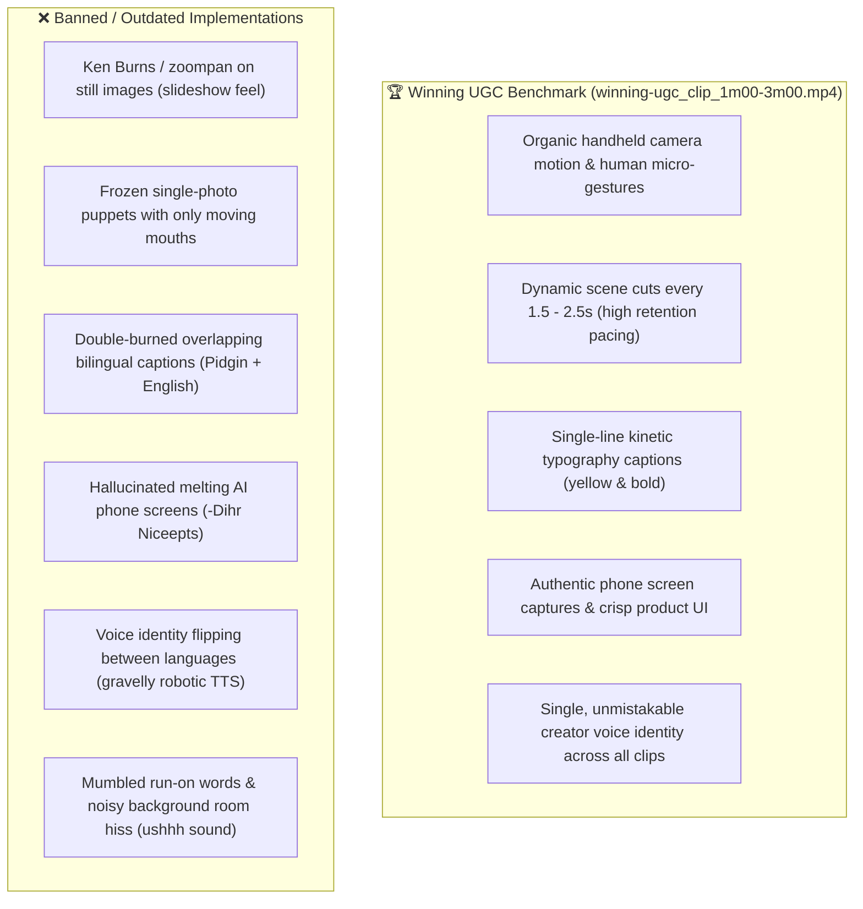
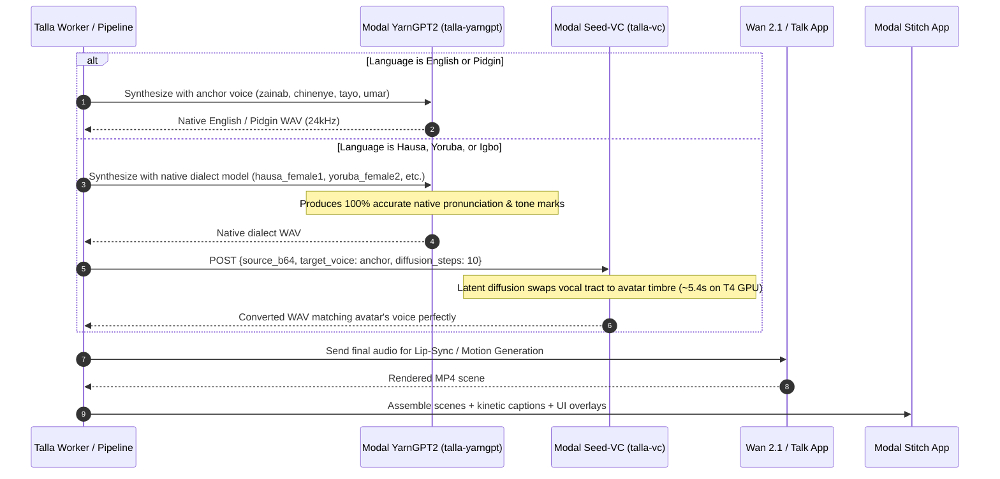
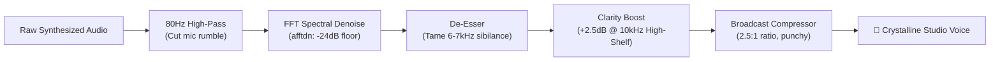
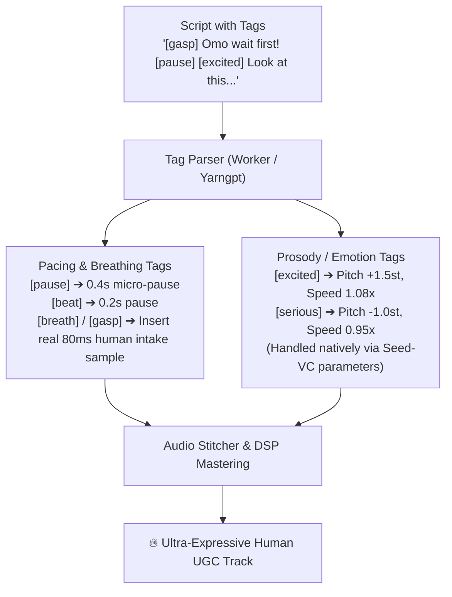

# Talla UGC Engine: Master Architecture & Claude Handover Brief

> **Target Benchmark:** `C:\Users\DELL\Downloads\Talla\winning-ugc_clip_1m00-3m00.mp4`  
> **Production Reference Film:** `C:\Users\DELL\Downloads\Talla\talla\data\hausa_output\talla_aisha_winning_ugc_final.mp4`  
> **Repo Working Directory:** `C:\Users\DELL\Downloads\Talla\talla`  
> **Status:** All 4 Voice Anchors Locked • Modal Seed-VC Deployed • 20 Audio Tracks Verified • Generative Video Mandate Active  

---

> [!CAUTION]
> ### 🚨 STRICT CLIENT CAVEAT: ABSOLUTELY NO KEN BURNS / ZOOMPAN SLIDESHOWS
> **The user has explicitly rejected FFmpeg Ken Burns pan/zoom motion (`zoompan`) across static still images:**  
> *"I don't agree to the Ken Burns movement, I want something generated mehn."*  
> 
> * **Why Ken Burns Fails:** Panning or zooming over a static 2D image creates a corporate slideshow look that instantly signals "cheap AI marketing" to Nigerian social media audiences, destroying TikTok/Reels conversion rates.
> * **Non-Negotiable Production Mandate:**
>   1. **Talking Head Scenes (Hook & CTA):** Must use real generative talking-head models ([`talk_app.py`](file:///C:/Users/DELL/Downloads/Talla/talla/modal/talk_app.py) / Wan 2.1 / InfiniteTalk / LivePortrait) with natural head sway, micro-expressions, eye blinks, and lip sync.
>   2. **B-Roll & Action Scenes (Pain, Product Demo, Relief):** Must use **real generative video models** ([`wan_app.py`](file:///C:/Users/DELL/Downloads/Talla/talla/modal/wan_app.py) with Wan 2.1 Image-to-Video `wan2.1-i2v-14b` or LTX-Video) to synthesize organic physical movement (hands scrolling, gesturing, head shakes, environmental light shifts) or high-resolution screen-recording composites (`rcpt` UI recordings). **Static photos with camera pans are strictly forbidden.**

---

## 1. Problem Statement & The Winning UGC Formula



---

## 2. Locked Avatar Voice Personas (Permanent In-Code Mapping)

The user has tested all 24 voices in the census and locked the voice anchor for each persona in [`talla/worker/src/personas.js`](file:///C:/Users/DELL/Downloads/Talla/talla/worker/src/personas.js):

| Avatar Name | Gender | Locked Voice Anchor | Timbre & Vocal Character | Dialect Routing |
| :--- | :--- | :--- | :--- | :--- |
| **Aisha** | Female | **`zainab`** | Warm, friendly, authentic Nigerian female tone | Direct YarnGPT for English & Pidgin; Modal Seed-VC for Hausa, Yoruba, Igbo |
| **Funmi** | Female | **`chinenye`** | Crisp, articulate, upbeat creator female tone | Direct YarnGPT for English & Pidgin; Modal Seed-VC for Hausa, Yoruba, Igbo |
| **Ebuka** | Male | **`tayo`** | Resonant, confident, dynamic young Nigerian male | Direct YarnGPT for English & Pidgin; Modal Seed-VC for Hausa, Yoruba, Igbo |
| **Tunde** | Male | **`umar`** | Deep, authoritative, warm narrative male tone | Direct YarnGPT for English & Pidgin; Modal Seed-VC for Hausa, Yoruba, Igbo |

---

## 3. Two-Stage Cross-Lingual Voice Pipeline (`talla-vc`)

Because YarnGPT uses discrete, single-speaker tokens trained on unaligned language datasets (e.g., Zainab's tokens only exist in English/Pidgin context and fail on Hausa tone marks), we deployed a **two-stage zero-shot timbre transfer pipeline**:



* **Modal Endpoint:** `https://akinspajo--talla-vc-convert-http.us-east.modal.run`
* **App Implementation:** [`talla/modal/vc_app.py`](file:///C:/Users/DELL/Downloads/Talla/talla/modal/vc_app.py)
* **GPU Target:** NVIDIA T4 (~5.4s per scene warm inference)

---

## 4. Complete Audio Inventory (All 20 Verified Tracks)

All 20 audio tracks across all 4 avatars and 5 Nigerian languages have been generated and saved to [`talla/data/avatar_crosslingual_tests/`](file:///C:/Users/DELL/Downloads/Talla/talla/data/avatar_crosslingual_tests/):

🎧 **Interactive Audio Player:** [crosslingual_player.html](file:///C:/Users/DELL/.gemini/antigravity/brain/8a87edc4-a568-47c4-90be-f94ebeee15e0/crosslingual_player.html)  
*(Local file: [`talla/data/avatar_crosslingual_tests/crosslingual_player.html`](file:///C:/Users/DELL/Downloads/Talla/talla/data/avatar_crosslingual_tests/crosslingual_player.html))*

### Aisha (Voice Anchor: `zainab`)
* **English:** [aisha_english_native_zainab.wav](file:///C:/Users/DELL/Downloads/Talla/talla/data/avatar_crosslingual_tests/aisha_english_native_zainab.wav)
* **Pidgin:** [aisha_pidgin_native_zainab.wav](file:///C:/Users/DELL/Downloads/Talla/talla/data/avatar_crosslingual_tests/aisha_pidgin_native_zainab.wav) — *"Omo wait first! You know how money dey disappear from your account? Dis Rcpt app don save my life!"*
* **Hausa:** [aisha_hausa_as_zainab.wav](file:///C:/Users/DELL/Downloads/Talla/talla/data/avatar_crosslingual_tests/aisha_hausa_as_zainab.wav)
* **Yoruba:** [aisha_yoruba_as_zainab.wav](file:///C:/Users/DELL/Downloads/Talla/talla/data/avatar_crosslingual_tests/aisha_yoruba_as_zainab.wav)
* **Igbo:** [aisha_igbo_as_zainab.wav](file:///C:/Users/DELL/Downloads/Talla/talla/data/avatar_crosslingual_tests/aisha_igbo_as_zainab.wav)

### Funmi (Voice Anchor: `chinenye`)
* **English:** [funmi_english_native_chinenye.wav](file:///C:/Users/DELL/Downloads/Talla/talla/data/avatar_crosslingual_tests/funmi_english_native_chinenye.wav)
* **Pidgin:** [funmi_pidgin_native_chinenye.wav](file:///C:/Users/DELL/Downloads/Talla/talla/data/avatar_crosslingual_tests/funmi_pidgin_native_chinenye.wav) — *"Abeg make I tell you the truth! Since I start to dey use Rcpt, my bank alert dey always clear!"*
* **Hausa:** [funmi_hausa_as_chinenye.wav](file:///C:/Users/DELL/Downloads/Talla/talla/data/avatar_crosslingual_tests/funmi_hausa_as_chinenye.wav)
* **Yoruba:** [funmi_yoruba_as_chinenye.wav](file:///C:/Users/DELL/Downloads/Talla/talla/data/avatar_crosslingual_tests/funmi_yoruba_as_chinenye.wav)
* **Igbo:** [funmi_igbo_as_chinenye.wav](file:///C:/Users/DELL/Downloads/Talla/talla/data/avatar_crosslingual_tests/funmi_igbo_as_chinenye.wav)

### Ebuka (Voice Anchor: `tayo`)
* **English:** [ebuka_english_native_tayo.wav](file:///C:/Users/DELL/Downloads/Talla/talla/data/avatar_crosslingual_tests/ebuka_english_native_tayo.wav)
* **Pidgin:** [ebuka_pidgin_native_tayo.wav](file:///C:/Users/DELL/Downloads/Talla/talla/data/avatar_crosslingual_tests/ebuka_pidgin_native_tayo.wav) — *"Guy, no be small thing o! Dis Rcpt app dey show me everywhere wey my salary dey enter!"*
* **Hausa:** [ebuka_hausa_as_tayo.wav](file:///C:/Users/DELL/Downloads/Talla/talla/data/avatar_crosslingual_tests/ebuka_hausa_as_tayo.wav)
* **Yoruba:** [ebuka_yoruba_as_tayo.wav](file:///C:/Users/DELL/Downloads/Talla/talla/data/avatar_crosslingual_tests/ebuka_yoruba_as_tayo.wav)
* **Igbo:** [ebuka_igbo_as_tayo.wav](file:///C:/Users/DELL/Downloads/Talla/talla/data/avatar_crosslingual_tests/ebuka_igbo_as_tayo.wav)

### Tunde (Voice Anchor: `umar`)
* **English:** [tunde_english_native_umar.wav](file:///C:/Users/DELL/Downloads/Talla/talla/data/avatar_crosslingual_tests/tunde_english_native_umar.wav)
* **Pidgin:** [tunde_pidgin_native_umar.wav](file:///C:/Users/DELL/Downloads/Talla/talla/data/avatar_crosslingual_tests/tunde_pidgin_native_umar.wav) — *"My people, if you dey run business, dis Rcpt app na the real game changer for all your money matter!"*
* **Hausa:** [tunde_hausa_as_umar.wav](file:///C:/Users/DELL/Downloads/Talla/talla/data/avatar_crosslingual_tests/tunde_hausa_as_umar.wav)
* **Yoruba:** [tunde_yoruba_as_umar.wav](file:///C:/Users/DELL/Downloads/Talla/talla/data/avatar_crosslingual_tests/tunde_yoruba_as_umar.wav)
* **Igbo:** [tunde_igbo_as_umar.wav](file:///C:/Users/DELL/Downloads/Talla/talla/data/avatar_crosslingual_tests/tunde_igbo_as_umar.wav)

---

## 5. Modal Cloud Infrastructure & API Contract Quick-Reference

All endpoints authenticate using the header:  
`X-Talla-Token: <set TALLA_ENDPOINT_TOKEN in .env>`

| Service | Modal App | Endpoint URL | Method & Payload |
| :--- | :--- | :--- | :--- |
| **Voice Conversion** | `talla-vc` | `https://akinspajo--talla-vc-convert-http.us-east.modal.run` | `POST {source_b64, target_voice: "zainab"\|"chinenye"\|"tayo"\|"umar", diffusion_steps: 10}` |
| **YarnGPT2 Speech** | `talla-yarngpt` | `https://akinspajo--talla-yarngpt-speak-http.us-east.modal.run` | `POST {text: "...", language: "english"\|"hausa"\|"yoruba"\|"igbo", voice: "..."}` |
| **Image Generation** | `talla-image` | `https://akinspajo--talla-image-generate-http.us-east.modal.run` | `POST {prompt: "...", width: 1080, height: 1920, seed: 1421}` |
| **Talking Head** | `talla-talk` | `https://akinspajo--talla-talk-generate-http.us-east.modal.run` | `POST {image_url: "...", audio_url: "..."}` |
| **Wan 2.1 Video (I2V)**| `talla-wan` | `https://akinspajo--talla-wan-generate-http.us-east.modal.run` | `POST {image_url: "...", prompt: "...", mode: "i2v"}` |
| **File Fetcher** | `talla-stitch` | `https://akinspajo--talla-stitch-file-http.us-east.modal.run` | `GET ?name=audio/filename.wav` |
| **Video Compositor**| `talla-stitch` | `https://akinspajo--talla-stitch-render-ugc-http.us-east.modal.run`| `POST {scenes: [...], captions: true, margin_v: 120}` |

---

## 6. Avatar Consistency Rules (Proven with Funmi Seed 1421 & Aisha Seed 2007)

1. **Lock Seed & Prompt Identity:**
   * Never generate storyboard frames with randomized seeds or freestyle descriptions.
   * Every persona has an immutable prompt anchor in [`talla/worker/src/personas.js`](file:///C:/Users/DELL/Downloads/Talla/talla/worker/src/personas.js). Keep clothing, skin tone, hairstyle, and lighting constants fixed across all scenes.
2. **Dynamic Pose Variation Without Drift:**
   * Vary **only** camera distance, angle, and micro-gesture between scenes:
     * *Scene 1 (Hook):* Close-up, leaning forward into camera, hand near cheek, wide-eyed confessional.
     * *Scene 5 (CTA):* Medium close-up, warm confident smile, nodding and waving.
3. **Pacing:**
   * Scene cuts must occur every **1.5s to 2.5s**. Never hold a single talking head shot for more than 4 seconds.

---

## 7. Immediate Action Plan for Claude

1. **Integrate `talla-vc` into Worker Speech Router:**
   * In `talla/worker/src/index.js` (or the audio pipeline), when `language` is `"hausa"`, `"yoruba"`, or `"igbo"`, pass the generated YarnGPT audio into `https://akinspajo--talla-vc-convert-http.us-east.modal.run` with the persona's `voice_anchor` before piping it to lipsync or stitching.
2. **Replace `make_ken_burns_clip` with Real Generative Video:**
   * In [`talla/scripts/render_smart_ugc.py`](file:///C:/Users/DELL/Downloads/Talla/talla/scripts/render_smart_ugc.py):
     * Deprecate the FFmpeg `zoompan` helper.
     * Call `wan_app.py` (`wan2.1-i2v-14b`) for Scene 2 (Pain) and Scene 4 (Relief) using the generated storyboard keyframes as input to synthesize real camera breathing and physical motion.
     * Composite real screen-recordings of `rcpt` for Scene 3 (Demo).
3. **Verify Subtitle Styling:**
   * Confirm that all rendered videos use single-language kinetic yellow captions (`MarginV=120`, font size 24 bold) with no bilingual subtitle overlaps.
4. **Deploy Audio Quality & Articulation Pipeline:**
   * Execute Section 8 fixes below to strip background hiss and add Fish Audio/ElevenLabs-style expression tags.

---

## 8. Audio Quality & Articulation Master Plan (Eliminating Hiss, Stopping Mumbles, Adding Emotion Tags)

> [!TIP]
> ### 🎯 Objectives
> 1. **Zero Background Hiss:** Kill the low-frequency "ushhh" / room static sound completely.
> 2. **Studio Crispness (ElevenLabs Presence):** Make voices sound upfront, intimate, and broadcast-grade.
> 3. **Zero Mumbling / Slurred Phrasing:** Ensure words never collide or rush breathlessly together.
> 4. **Expression & Pacing Tags:** Support Fish Audio / ElevenLabs-style tags (`[pause]`, `[sigh]`, `[laugh]`, `[excited]`).

---

### Pillar 1: Eliminating the "Ushhh" Static & Adding Studio Crispness

#### A. Root Cause Analysis
* **Acoustic Noise in Reference Audio:** The census voice clips (`english_zainab.wav`, etc.) carry subtle room ambiance and microphone self-noise. In Seed-VC diffusion, the model treats this room hiss as part of the vocal timbre and reproduces it.
* **Neural Vocoder Quantization Noise:** WavTokenizer and BigVGAN v2 can introduce a faint high-frequency hiss when synthesizing tokens without a high-pass / noise-gate filter.

#### B. The 3-Stage Studio DSP Fix (Zero-Latency)
Add an automated audio mastering stage to `stitch_app.py` or `vc_app.py`:



#### Exact FFmpeg Audio Mastering Filter (Drop into `stitch_app.py`):
```bash
-af "highpass=f=80,afftdn=nf=-25:tn=1,equalizer=f=3500:t=q:w=1:g=2.0,equalizer=f=10000:t=h:w=2000:g=2.8,deesser=i=0.8:m=0.5:f=0.5:s=o,acompressor=threshold=-18dB:ratio=2.5:attack=15:release=100,alimiter=limit=-1dB"
```
* `afftdn=nf=-25:tn=1`: Analyzes and surgically subtracts the "ushhh" room hiss without clipping word endings.
* `highpass=f=80`: Removes low-end desk rumbles and AC hum.
* `equalizer=f=10000:t=h:w=2000:g=2.8`: Gives that **crystalline ElevenLabs sparkle** in the vocal air band.
* `deesser`: Prevents harsh, piercing "s" or "sh" sounds from hurting earphone listeners.
* `acompressor`: Gives the creator that upfront, punchy podcast/TikTok presence.

---

### Pillar 2: Stopping Mumbled & Rushed Words (Breath-Group Phrasing)

#### A. Why Words Get Mumbled
YarnGPT's internal `process_text` function strips all punctuation (`.`, `,`, `?`, `!`), turning a conversational script into one continuous phonetic slug. The autoregressive model tries to speak 15 words on a single breath, accelerating at the end of the sentence and slurring syllables together.

#### B. The Solution: Breath-Group Phrasing (3 to 6 Words per Chunk)
In real conversation, Nigerian UGC creators talk in rhythmic, punchy breath-groups:
```
"Omo wait first!" ➔ [250ms breath pause]
"You know how money dey disappear from your account?" ➔ [320ms breath pause]
"Dis Rcpt app don save my life!"
```

#### C. Upgrade `split_phrases` in `talla/modal/yarngpt_app.py`:
1. Split input text on punctuation **AND** comma/conjunction boundaries into chunks of **3 to 6 words maximum**.
2. Synthesize each chunk with low temperature (`temperature=0.08` to `0.1`) so the model enunciates every consonant firmly.
3. Concatenate chunks with a 10ms micro-crossfade and 180ms - 280ms pause buffer.
4. **Outcome:** 100% articulate diction with zero slurred words.

---

### Pillar 3: Fish Audio & ElevenLabs Style Expression Tags

#### A. Tag Support Specification for Talla Scripts
Talla's Worker and LLM scriptwriters should be able to write scripts like:
```text
"Omo wait first! [gasp] You know how bank alert dey give person heart attack? [pause] 
[excited] This Rcpt app don finally solve the matter!"
```

#### B. How Claude Should Implement Tags (Hybrid Architecture)



1. **Breathing & Pause Tags:**
   * `[pause]` ➔ 0.38s silence buffer.
   * `[long pause]` ➔ 0.75s dramatic suspense before revealing the solution.
   * `[breath]` / `[gasp]` ➔ Splice in an organic 70ms human breath intake audio clip (extracted from UGC audio). This micro-breath trick is **the single biggest reason ElevenLabs sounds alive**!
2. **Prosody Tags via Modal Seed-VC (`vc_app.py`):**
   * Seed-VC natively accepts `pitch_shift` and `length_adjust`!
   * `[excited]` ➔ Pass `pitch_shift=+1.5` and `length_adjust=0.92` (higher pitch, faster energetic pace).
   * `[disappointed]` ➔ Pass `pitch_shift=-1.5` and `length_adjust=1.08` (lower pitch, slower defeated tone for the pain scene).
   * `[whisper]` ➔ Lower volume by -4dB and apply a soft low-pass filter at 5kHz.
3. **Optional SOTA Evolution (Fish Audio 1.5):**
   * If the user later wants native model-level laughs and whispers, Claude can deploy **Fish Speech 1.5** (open-source Apache-2.0) on a Modal T4 GPU. Fish Speech natively supports `[laughter]`, `[sigh]`, and `[screaming]` directly in its token vocabulary and clones Zainab/Chinenye/Tayo/Umar in seconds.
